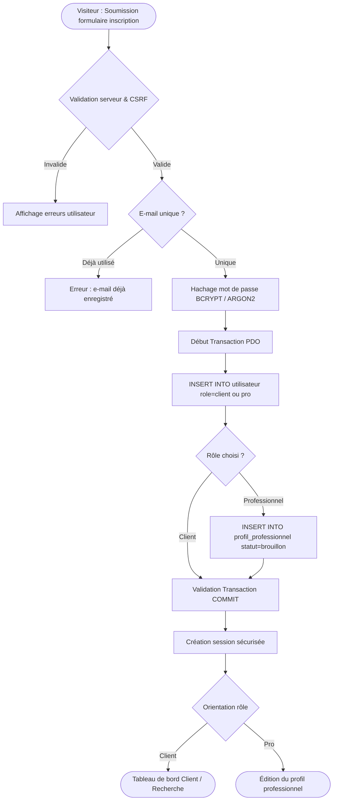
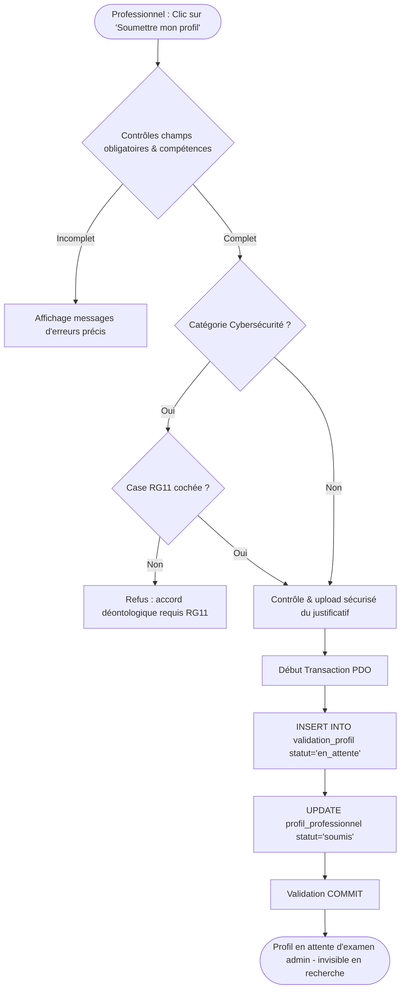
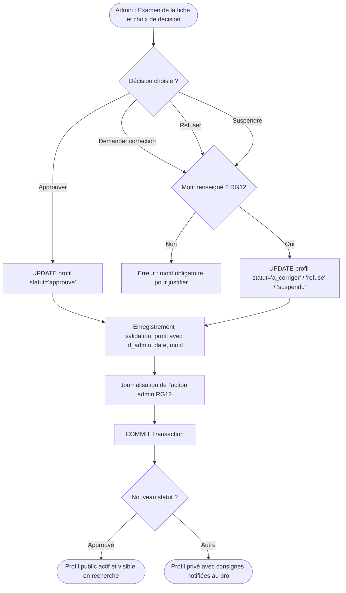
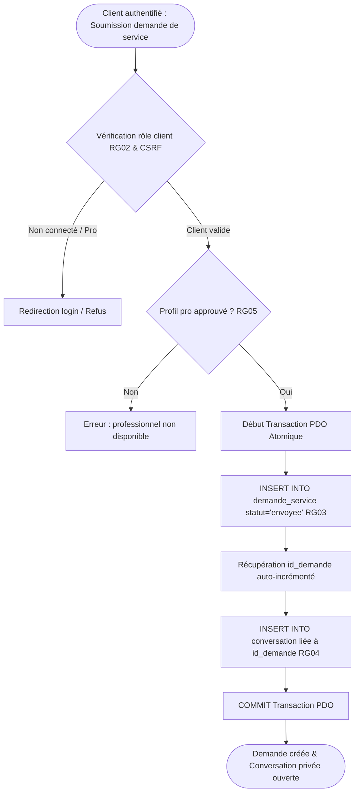
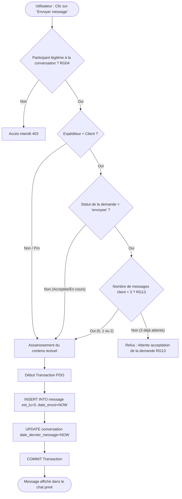
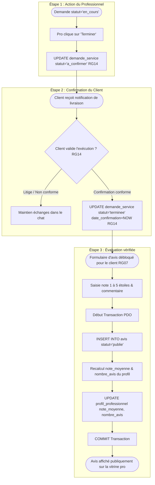

# Modèle Conceptuel des Traitements (MCT) — FindPro

Ce document formalise la dynamique et les processus métier de la plateforme **FindPro**. Chaque traitement est détaillé sous la forme d'une séquence d'opérations rigoureuse, en conformité avec les règles de gestion (**RG01 à RG14**) et le dictionnaire de données.

---

## 1. Traitement : Inscription (Client et Professionnel)

### Fiche du traitement

* **Événement déclencheur :** Le visiteur soumet le formulaire d'inscription sur la page `/inscription.php` (choix du profil : *Client* ou *Professionnel*).
* **Acteur :** Visiteur non authentifié.
* **Conditions préalables :**
  1. Tous les champs obligatoires sont renseignés (Nom, Prénom, E-mail, Téléphone, Mot de passe, Confirmation, Rôle).
  2. L'adresse e-mail a un format valide et n'existe pas déjà dans la base (unicité).
  3. Le numéro de téléphone respecte le format attendu (ex. : `+225...`).
  4. Le mot de passe comporte au minimum 8 caractères avec au moins une lettre et un chiffre (**RG08**).
  5. Pour un professionnel : acceptation des conditions d'engagement et choix d'une commune d'exercice principale.
  6. Le jeton CSRF soumis est valide.
* **Opérations (séquence numérotée) :**
  1. **Validation des entrées :** Le serveur assainit et valide les données transmises via `POST`.
  2. **Contrôle d'unicité :** Vérification de la disponibilité de l'adresse e-mail via requête préparée PDO.
  3. **Hachage du mot de passe :** Génération de l'empreinte sécurisée avec `password_hash($motDePasse, PASSWORD_DEFAULT)` (**RG08**).
  4. **Ouverture de transaction SQL :** Démarrage de la transaction PDO.
  5. **Création du compte utilisateur :** Insertion dans `utilisateur` (`nom`, `prenom`, `email`, `telephone`, `mot_de_passe`, `role`, `est_actif=1`, `date_creation=NOW()`).
  6. **Initialisation selon le rôle :**
     * Si `role == 'client'` : aucun enregistrement secondaire requis.
     * Si `role == 'professionnel'` : création automatique de l'entrée liée dans `profil_professionnel` (`id_utilisateur`, `titre_professionnel`, `commune`, `statut_profil='brouillon'`, `disponibilite=1`, `note_moyenne=0.00`, `nombre_avis=0`, `date_creation=NOW()`).
  7. **Validation de transaction :** `COMMIT` de la transaction PDO.
  8. **Initialisation de session :** Création de la session PHP sécurisée avec le rôle de l'utilisateur (**RG09**).
  9. **Redirection :**
     * Client : redirection vers l'espace client `/client/demandes.php` ou la recherche.
     * Professionnel : redirection vers le formulaire de complétion de profil `/pro/completer-profil.php`.
* **Résultat :** Le compte est actif, l'utilisateur est authentifié dans sa session et orienté vers son espace dédié.
* **Données modifiées :**
  * `utilisateur` : Insertion de la ligne avec `est_actif = 1`.
  * `profil_professionnel` : Insertion avec `statut_profil = 'brouillon'` (si professionnel).

### Diagramme Mermaid

---

## 2. Traitement : Soumission du Profil Professionnel

### Fiche du traitement

* **Événement déclencheur :** Le professionnel clique sur "Soumettre mon profil pour validation" depuis son espace `/pro/editer-profil.php`.
* **Acteur :** Professionnel connecté (`role == 'professionnel'`).
* **Conditions préalables :**
  1. L'utilisateur a une session active de professionnel (**RG09**).
  2. Le profil est actuellement au statut `'brouillon'` ou `'a_corriger'`.
  3. Tous les champs obligatoires du profil sont renseignés : titre professionnel, biographie (minimum 50 caractères), années d'expérience, commune, adresse/quartier.
  4. Au moins une compétence technique principale a été associée au profil via `profil_competence`.
  5. Une pièce d'identité ou justificatif valide a été téléversée (format PDF/JPG/PNG, taille < 5 Mo, contrôle MIME strict).
  6. **Contrôle spécifique Cybersécurité (RG11) :** Si la catégorie rattachée concerne la cybersécurité (audit, pentest), la case obligatoire d'engagement déontologique et d'autorisation expresse du propriétaire du système cible doit être impérativement cochée.
* **Opérations (séquence numérotée) :**
  1. **Vérification de sécurité :** Contrôle du jeton CSRF et de l'appartenance du profil à l'utilisateur en session.
  2. **Contrôle d'exhaustivité :** Vérification côté serveur de tous les champs obligatoires et présence d'au moins 1 compétence.
  3. **Vérification conditionnelle cybersécurité :** Si catégorie = *Cybersécurité*, blocage si la case `acceptation_charte_cyber` n'est pas cochée (**RG11**).
  4. **Traitement du fichier justificatif :**
     * Vérification de l'extension et du type MIME réel (`finfo`).
     * Renommage aléatoire sécurisé et déplacement hors de la racine publique vers `uploads/justificatifs/`.
  5. **Transaction SQL :**
     * Insertion dans `validation_profil` (`id_profil`, `type_document`, `fichier_justificatif`, `statut_decision='en_attente'`, `date_soumission=NOW()`).
     * Mise à jour de `profil_professionnel` : `statut_profil = 'soumis'`, `date_modification = NOW()`.
  6. **Validation :** `COMMIT` de la transaction.
  7. **Notification :** Message flash de confirmation informant le professionnel que son dossier est en attente d'instruction.
* **Résultat :** Le profil passe à l'état `'soumis'` (ou `'en_verification'`), il reste non visible dans la recherche publique (**RG01, RG05**) jusqu'à décision d'un administrateur.
* **Données modifiées :**
  * `profil_professionnel` : `statut_profil = 'soumis'`, `date_modification = NOW()`.
  * `validation_profil` : Insertion d'un nouvel enregistrement avec `statut_decision = 'en_attente'`.

### Diagramme Mermaid

---

## 3. Traitement : Validation par l'Administrateur

### Fiche du traitement

* **Événement déclencheur :** L'administrateur valide son formulaire de décision depuis la file de modération `/admin/validation-detail.php?id=...`.
* **Acteur :** Administrateur authentifié (`role == 'admin'`).
* **Conditions préalables :**
  1. L'administrateur possède une session valide avec le rôle `'admin'` (**RG09**).
  2. Le dossier sélectionné dans `validation_profil` est à l'état `'en_attente'`.
  3. L'administrateur choisit une action parmi les quatre options :
     * **Approuver** : le dossier est complet et certifié.
     * **Demander correction** : des modifications mineures sont exigées (motif obligatoire).
     * **Refuser** : la candidature est définitivement rejetée (motif obligatoire).
     * **Suspendre** : suspension d'un profil déjà en ligne ou abus avéré (motif obligatoire).
  4. Pour toute décision autre que *Approuver*, le champ `commentaire_admin` (motif) est **strictement obligatoire** (**RG12**).
* **Opérations (séquence numérotée) :**
  1. **Contrôle d'accès et CSRF :** Vérification des privilèges `admin` et validation du jeton.
  2. **Contrôle de conformité de la décision :**
     * Si décision $\in$ `{'a_corriger', 'refuse', 'suspendu'}` et motif vide $\to$ interruption avec message d'erreur.
  3. **Début de transaction SQL :**
  4. **Mise à jour de l'instruction (`validation_profil`) :**
     * `statut_decision = :decision`
     * `id_admin = :id_admin` (**RG12 — Qui**)
     * `commentaire_admin = :motif` (**RG12 — Pourquoi**)
     * `date_decision = NOW()` (**RG12 — Quand**)
  5. **Mise à jour de l'état du profil (`profil_professionnel`) :**
     * Si approuvé : `statut_profil = 'approuve'` (débloque la visibilité publique **RG01, RG05**).
     * Si correction demandée : `statut_profil = 'a_corriger'`.
     * Si refusé : `statut_profil = 'refuse'`.
     * Si suspendu : `statut_profil = 'suspendu'`.
  6. **Journalisation dans l'audit de modération :** Enregistrement de l'action dans les journaux système (**RG12**).
  7. **Validation :** `COMMIT` de la transaction.
  8. **Notification :** Mise à disposition de la décision et des consignes dans l'espace du professionnel.
* **Résultat :** Le statut du professionnel est actualisé ; s'il est approuvé, son profil devient consultable par tous les visiteurs. Toute décision est tracée avec identité, date, motif et action.
* **Données modifiées :**
  * `validation_profil` : `statut_decision`, `id_admin`, `commentaire_admin`, `date_decision`.
  * `profil_professionnel` : `statut_profil`, `date_modification`.

### Diagramme Mermaid

---

## 4. Traitement : Envoi d'une Demande de Service

### Fiche du traitement

* **Événement déclencheur :** Le client clique sur "Envoyer ma demande" depuis la fiche publique d'un professionnel `/demande.php?pro=...`.
* **Acteur :** Client authentifié (`role == 'client'`) (**RG02**).
* **Conditions préalables :**
  1. L'utilisateur émetteur est connecté avec le rôle `'client'` (**RG02**).
  2. Le professionnel sollicité a un profil actif et approuvé (`statut_profil == 'approuve'`) (**RG01, RG05**).
  3. Le client et le professionnel sont deux personnes distinctes (`id_client != id_pro`).
  4. Les champs obligatoires sont valides : `titre` (max 150 car.), `description` détaillée du besoin, `id_categorie`.
  5. Le `budget` est un entier positif en Francs CFA (**RG10 : aucun paiement n'est exécuté ou débité**).
  6. Si la demande porte sur une prestation de cybersécurité : le client atteste être le propriétaire légitime du système à tester (**RG11**).
* **Opérations (séquence numérotée) :**
  1. **Contrôles de sécurité :** Vérification de la session client et du jeton CSRF.
  2. **Vérification de l'état du pro :** Requête PDO vérifiant que le professionnel est bien `'approuve'`.
  3. **Début de transaction SQL atomique :**
  4. **Création de la demande (`demande_service`) :**
     * Insertion de la demande avec : `id_client`, `id_profil`, `id_categorie`, `titre`, `description`, `budget`, `date_souhaitee`, `statut = 'envoyee'`, `date_creation = NOW()`.
     * Récupération de l'identifiant généré : `$idDemande = $pdo->lastInsertId()`.
  5. **Création conjointe de la conversation (`conversation`) :**
     * Récupération de l'`id_utilisateur` rattaché au `id_profil` du pro.
     * Insertion immédiate dans `conversation` (**RG04**) : `id_demande = $idDemande`, `id_client = $clientSession`, `id_professionnel = $proUtilisateur`, `date_dernier_message = NOW()`, `date_creation = NOW()`.
  6. **Premier message d'introduction automatique (optionnel) :** Insertion du texte initial de la demande dans `message` rattaché à la conversation.
  7. **Validation :** `COMMIT` de la transaction atomique (si une des deux insertions échoue, annulation totale par `ROLLBACK`).
  8. **Redirection :** Le client est redirigé vers `/client/demandes.php` ou directement vers la messagerie de la demande `/chat.php?conversation=...`.
* **Résultat :** La demande de service est créée au statut `'envoyee'` et son fil de discussion privé dédié est ouvert (**RG03, RG04**).
* **Données modifiées :**
  * `demande_service` : Insertion avec `statut = 'envoyee'`.
  * `conversation` : Insertion liée par `$idDemande`.

### Diagramme Mermaid

---

## 5. Traitement : Messagerie et Échanges

### Fiche du traitement

* **Événement déclencheur :** Le client ou le professionnel saisit un texte et clique sur "Envoyer" dans l'interface de messagerie `/chat.php?id=...`.
* **Acteur :** Client participant ou Professionnel participant à la conversation (**RG04**).
* **Conditions préalables :**
  1. L'utilisateur est connecté et fait partie des 2 seuls participants autorisés de la conversation (`id_expediteur IN (id_client, id_professionnel)`) (**RG04**).
  2. Le contenu du message n'est pas vide (après suppression des espaces superflus).
  3. **Contrôle de la limite avant acceptation (RG13) :**
     * Si l'expéditeur est le **Client** et que la demande liée a le statut `'envoyee'` (non encore acceptée par le pro) :
       * Compter les messages déjà envoyés par le client dans cette conversation.
       * Si `compteur >= 3` $\to$ **Envoi bloqué** avec notification : *"Limite de 3 messages atteinte en attente d'acceptation par le professionnel."*
     * Dès que la demande passe au statut `'acceptee'` ou `'en_cours'` : la limite est levée, échanges libres.
* **Opérations (séquence numérotée) :**
  1. **Vérification d'autorisation :** Le serveur vérifie que `id_utilisateur` en session est bien participant de la conversation (**RG04**).
  2. **Récupération du statut de la demande :** Requête PDO joignant `conversation` et `demande_service` pour lire `statut`.
  3. **Vérification de la règle RG13 :**
     * Si `role == 'client'` et `demande.statut == 'envoyee'` :
     * Exécuter `SELECT COUNT(*) FROM message WHERE id_conversation = :idConv AND id_expediteur = :idClient`.
     * Si `COUNT >= 3` : bloquer l'envoi et afficher l'alerte RG13.
  4. **Assainissement du texte :** Nettoyage des espaces et protection contre les attaques XSS.
  5. **Début de transaction SQL :**
  6. **Insertion du message (`message`) :**
     * `INSERT INTO message (id_conversation, id_expediteur, contenu, est_lu, date_envoi)` avec `est_lu = 0`, `date_envoi = NOW()`.
  7. **Mise à jour de la conversation (`conversation`) :**
     * `UPDATE conversation SET date_dernier_message = NOW() WHERE id_conversation = :idConv`.
  8. **Validation :** `COMMIT` de la transaction.
  9. **Réponse :** Retour JSON (si appel AJAX) ou rechargement du fil avec le nouveau message visible.
* **Résultat :** Le message est enregistré, horodaté, et le fil de discussion est remonté en tête de liste dans les boîtes de réception.
* **Données modifiées :**
  * `message` : Nouvelle ligne insérée.
  * `conversation` : `date_dernier_message = NOW()`.

### Diagramme Mermaid

---

## 6. Traitement : Fin de Prestation, Clôture et Dépôt d'Avis

### Fiche du traitement

* **Événement déclencheur :**
  * **Étape A :** Le professionnel clique sur "Marquer la prestation comme terminée" depuis son tableau de bord (`/pro/demandes.php`).
  * **Étape B :** Le client examine le résultat et clique sur "Confirmer la fin des travaux" (`/client/demandes.php`).
  * **Étape C :** Le formulaire de notation et d'avis s'ouvre pour le client (**RG07**).
* **Acteurs :** Professionnel puis Client (**RG14**).
* **Conditions préalables :**
  1. La demande est au statut initial `'en_cours'`.
  2. Seul le professionnel affecté peut marquer la prestation `a_confirmer` (**RG14**).
  3. Seul le client émetteur peut basculer la demande de `a_confirmer` à `terminee` via sa confirmation explicite (**RG14**).
  4. L'avis ne peut être déposé **que si et seulement si** la demande est au statut `terminee` (**RG07**).
  5. Un seul avis unique peut être émis par demande (`id_demande UNIQUE` dans `avis`).
  6. La note est un entier de 1 à 5 ; le commentaire est assaini.
* **Opérations (séquence numérotée) :**
  1. **Phase 1 — Marquage par le professionnel (RG14) :**
     * Le pro clique sur "Terminer les travaux".
     * Contrôle côté serveur : vérification que le statut actuel est `'en_cours'`.
     * `UPDATE demande_service SET statut = 'a_confirmer', date_modification = NOW() WHERE id_demande = :id`.
     * Notification au client d'une invitation à vérifier et confirmer la livraison.
  2. **Phase 2 — Confirmation par le client (RG14) :**
     * Le client clique sur "Confirmer la bonne exécution".
     * Contrôle côté serveur : vérification de l'identité du client et statut `'a_confirmer'`.
     * `UPDATE demande_service SET statut = 'terminee', date_confirmation = NOW(), date_modification = NOW() WHERE id_demande = :id`.
  3. **Phase 3 — Dépôt de l'avis par le client (RG07) :**
     * Le client renseigne la note (1 à 5 étoiles) et son commentaire.
     * Début de transaction SQL :
     * Insertion de l'avis : `INSERT INTO avis (id_demande, id_client, id_profil, note, commentaire, statut='publie', date_creation=NOW())`.
     * Recalcul automatique des métriques du professionnel :
       * `SELECT AVG(note), COUNT(*) FROM avis WHERE id_profil = :idPro AND statut = 'publie'`.
       * `UPDATE profil_professionnel SET note_moyenne = :nouvelleMoyenne, nombre_avis = :nouveauTotal WHERE id_profil = :idPro`.
     * `COMMIT` de la transaction.
* **Résultat :** La demande est officiellement close (`terminee`), l'avis est publié sur le profil public du professionnel avec mise à jour immédiate de sa note moyenne et de son compteur d'avis (**RG07, RG14**).
* **Données modifiées :**
  * `demande_service` : `statut = 'a_confirmer'` puis `statut = 'terminee'`, `date_confirmation = NOW()`.
  * `avis` : Insertion de la ligne avec note et commentaire.
  * `profil_professionnel` : Actualisation de `note_moyenne` et `nombre_avis`.

### Diagramme Mermaid

